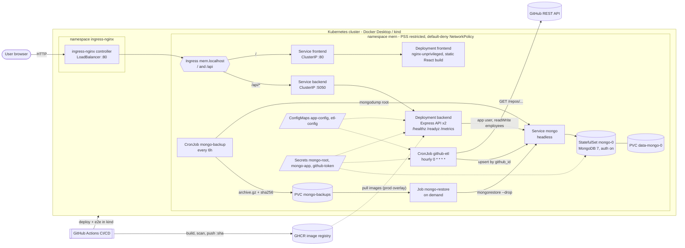
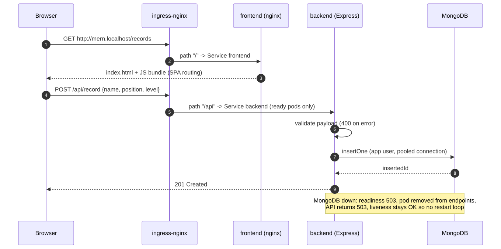
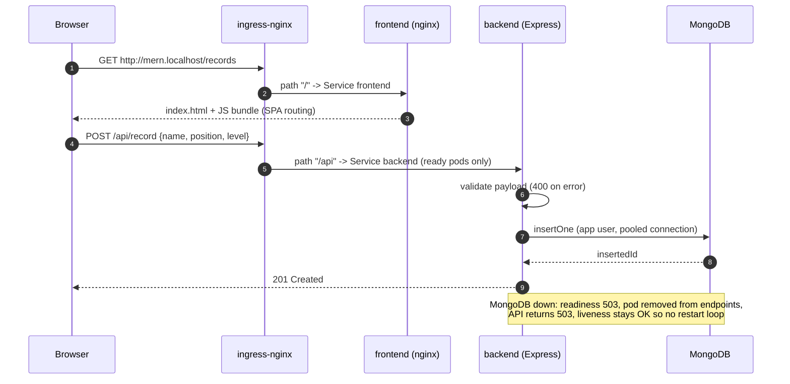

# Architecture

Editable sources: [`docs/diagrams/architecture.mmd`](diagrams/architecture.mmd), [`docs/diagrams/request-flow.mmd`](diagrams/request-flow.mmd) (Mermaid; GitHub renders the blocks below, and the rendered images are in [`architecture.svg`](architecture.svg) / [`request-flow.svg`](request-flow.svg)).
Regenerate the images with: `npx -p @mermaid-js/mermaid-cli mmdc -i docs/diagrams/architecture.mmd -o docs/architecture.svg`.

## Components and traffic flow





### External access points

| Entry point | Exposed how | Reachable from |
| --- | --- | --- |
| `http://mern.localhost/` (UI) | ingress-nginx (`LoadBalancer` on Docker Desktop → localhost:80) → Ingress → `frontend` ClusterIP | Outside the cluster |
| `http://mern.localhost/api/*` (REST API) | same Ingress, path `/api` → `backend` ClusterIP | Outside the cluster |
| Backend `/metrics`, `/healthz`, `/readyz` | not routed by the Ingress | Kubelet probes, Prometheus (in-cluster only) |
| MongoDB `:27017` | headless Service, NetworkPolicy allows backend/ETL/backup/restore pods only | In-cluster only |
| GitHub API | egress from the ETL CronJob | — |

## Request path (create a record)





1. The browser loads the static React build from the `frontend` pods (nginx, port 8080) through the Ingress.
2. All API calls use the same origin and the relative path `/api/...` (no CORS, no hard-coded host).
3. The Ingress sends `/api` directly to the `backend` Service, which load-balances across **ready** backend pods only.
4. The backend validates the payload and talks to MongoDB through the headless `mongo` Service using the least-privilege `app` user (connection pool, max 20 per pod).
5. The response travels back the same path. Logs from every hop are on stdout (`kubectl logs`), backend metrics on `/metrics`.

In docker-compose the same frontend image proxies `/api` to the backend itself (`BACKEND_URL`), so the browser code is identical in both environments.

## Batch workloads

| Workload | Kind | Schedule | Talks to |
| --- | --- | --- | --- |
| `github-etl` | CronJob | hourly (`0 * * * *`), `concurrencyPolicy: Forbid` | GitHub API → MongoDB `employees.github_repositories` (upsert on `github_id`) |
| `mongo-backup` | CronJob | every 6 h | MongoDB (root, read) → PVC `mongo-backups` |
| `mongo-restore` | Job (manual) | on demand | PVC `mongo-backups` → MongoDB (`--drop`, `employees.*`) |

## Repository layout

```
mern-project/server     Express API (+ Dockerfile, tests)
mern-project/client     React UI (+ Dockerfile, nginx template, Cypress)
python-project          GitHub ETL (+ Dockerfile, tests)
k8s/base                Kustomize base: all workloads, services, ingress, policies
k8s/overlays/dev        local cluster (images built locally, :local tag)
k8s/overlays/prod       GHCR images pinned to commit SHA, more replicas, HPA, TLS
k8s/jobs                on-demand jobs (restore, list backups)
k8s/monitoring          optional PodMonitor + PrometheusRule (kube-prometheus-stack)
scripts                 create-secrets (.ps1/.sh), e2e-k8s.sh
.github/workflows       CI/CD pipeline
docker-compose.yml      local development stack
```
